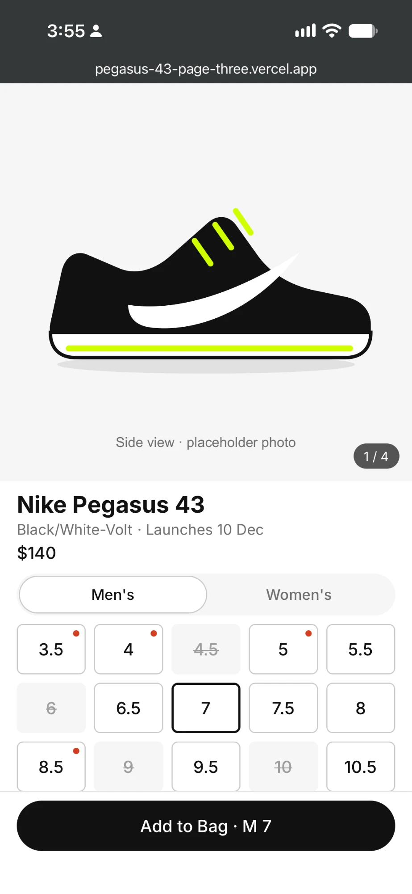

Live page: https://pegasus-43-page-three.vercel.app/

# Nike Pegasus 43 phone launch page

A phone-first product page for the Nike Pegasus 43 (Black/White-Volt, $140), built with Next.js and Tailwind CSS and deployed on Vercel.



## What it does

- Shows all 26 sizes in a grid of 5 per row. Stock comes from `data/sizes.json`, the 8 December 2026 snapshot: 10 in stock, 7 low stock, 9 sold out.
- Sold-out sizes stay in place, greyed out and untappable. Low-stock sizes carry a small dot.
- The size grid has a fixed height and every part above it has a set height, so the grid does not move while the page loads.

## Checks

| Check | Result on the live page |
| :- | :- |
| Lighthouse performance (mobile, Slow 4G, 4x CPU slowdown) | 98, budget 90 |
| Layout shift | 0 |
| Smallest size button side | 48px, budget 44px |

- Lighthouse report for the live page: [docs/lighthouse-live.report.html](docs/lighthouse-live.report.html) (data in [docs/lighthouse-live.report.json](docs/lighthouse-live.report.json))
- Budget: [speed-budget.json](speed-budget.json)
- Notes on the Slow 4G trace and the launch: [NOTES.md](NOTES.md)

## Run it

```bash
npm install
npm run build
npm run start -- -p 3211
```

Then open http://localhost:3211/.

```bash
npm run check:lighthouse   # Lighthouse CI with the Slow 4G phone settings
npm run check:grid         # size grid movement and button sizes, page must be running on 3211
```

Photos, tech copy and reviews on the page are placeholders.
